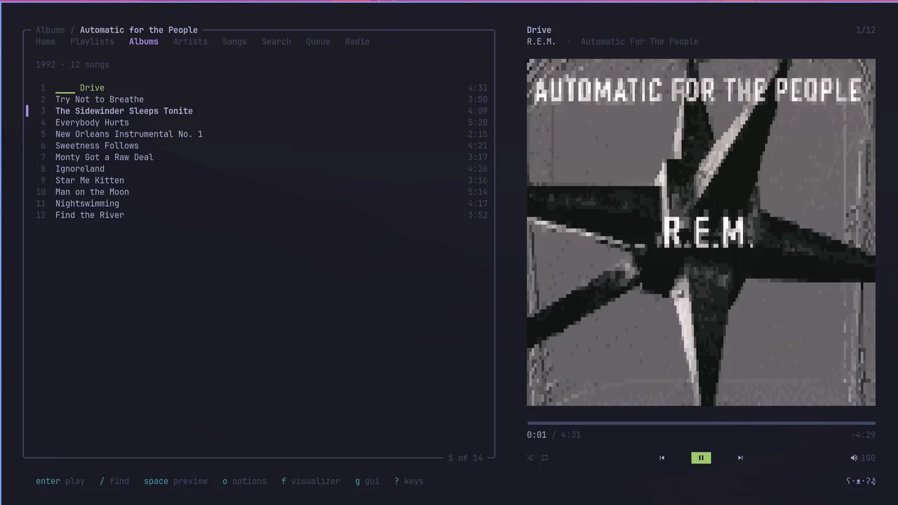
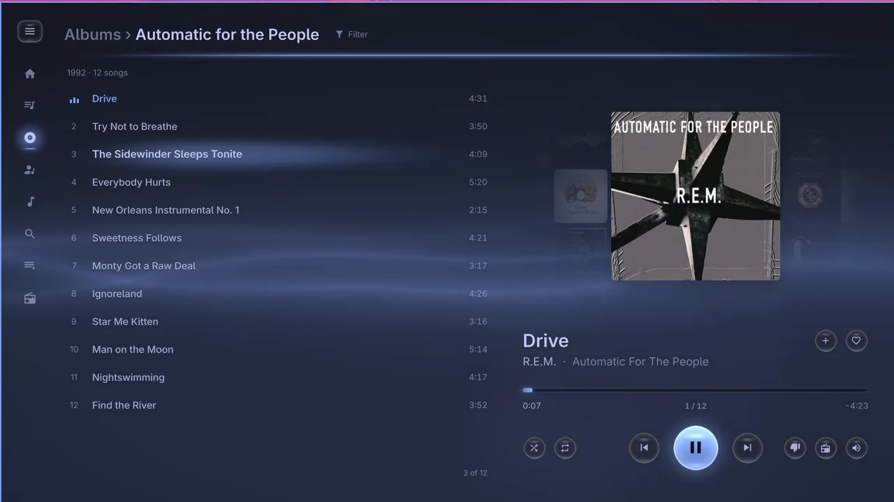
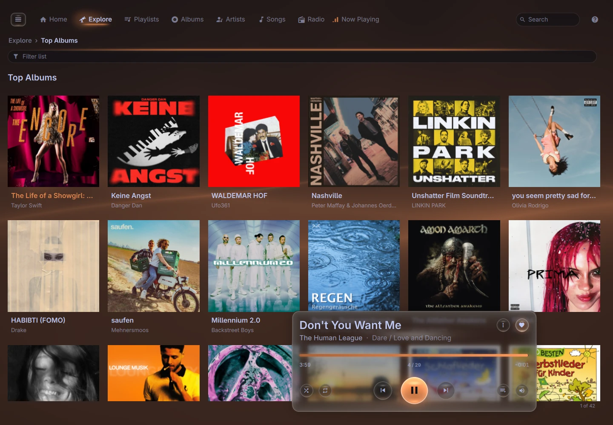
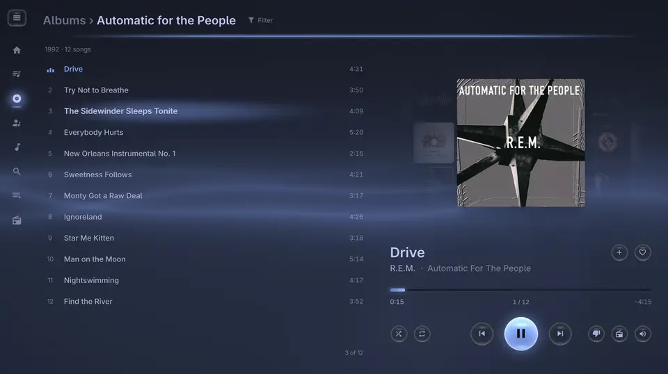
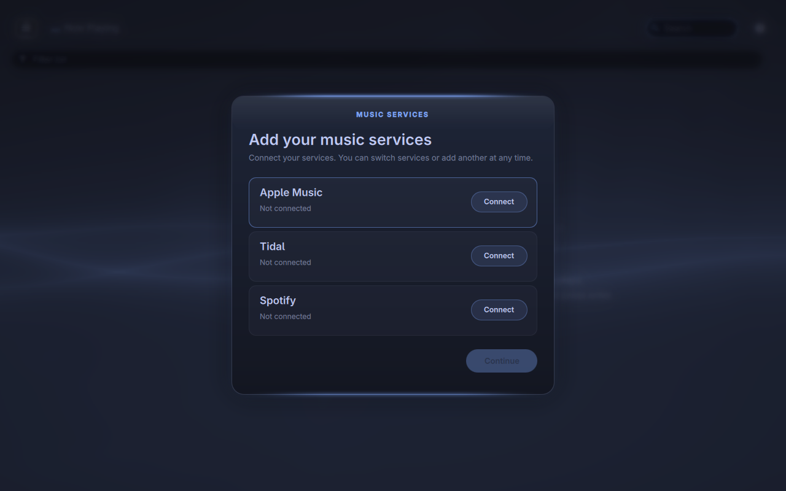
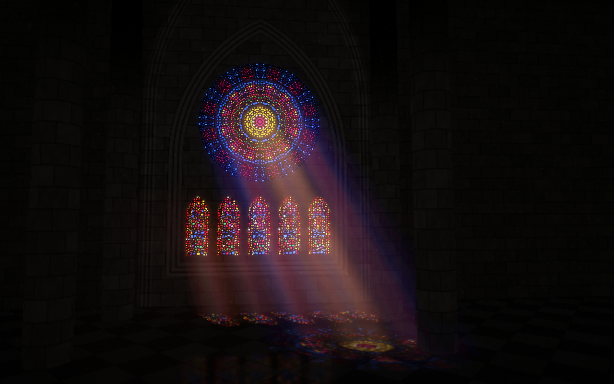

# 

**Music player for [Omarchy](https://omarchy.org) & Linux, with GUI & TUI**

- 🎧 Supported services: Apple Music by [@chriopter](https://github.com/chriopter), Tidal by [@keylimesoda](https://github.com/keylimesoda), Spotify by [@sean-imus](https://github.com/sean-imus). [Details](#music-services)
- ⇄ GUI and TUI: press <kbd>g</kbd> to switch while music keeps playing
- 🎵 Library, playlists, favorites and search as you type
- 🧭 Home and Explore: recommendations, charts, artists and radio
- 🎬 Music video previews in the GUI
- 🌈 Cover art and thirteen visualizers
- ⌨️ Keyboard and mouse controls
- 🐧 Desktop theme, media keys and bar widget

## Install

```sh
curl -fsSL https://github.com/chriopter/brumm/releases/latest/download/install.sh | bash
```

Music-video previews need Qt 6 Multimedia. The installer adds
`qt6-multimedia` on Omarchy and Arch Linux; install your distribution's
Qt 6 Multimedia QML package on other Linux systems.

| TUI | GUI |
|:---:|:---:|
|  |  |
| **Explore** | **Visualizer** |
|  |  |

## Keys

Press <kbd>?</kbd> in brumm for the full shortcut list.

| Action | Shortcut |
|---|---|
| Play or open the selection | <kbd>Enter</kbd> |
| Pause or resume | <kbd>Space</kbd> |
| Switch between GUI and TUI | <kbd>g</kbd> |
| Filter or search | <kbd>/</kbd> |
| Connect or switch music services | <kbd>Ctrl</kbd> + <kbd>O</kbd> |
| Open or close the visualizer | <kbd>f</kbd> |
| Close the interface, keep music playing | <kbd>Shift</kbd> + <kbd>Q</kbd> |
| Quit brumm and stop the music | <kbd>q</kbd> |

While filtering, press <kbd>Tab</kbd> to search the entire service.

<details>
<summary>More player shortcuts</summary>

| Action | Shortcut |
|---|---|
| Switch section | <kbd>1</kbd>–<kbd>9</kbd> |
| Show Now Playing and the queue | <kbd>c</kbd> |
| Open options | <kbd>o</kbd> |
| Next track | <kbd>n</kbd> |
| Previous track | <kbd>p</kbd> |
| Preview the selection | Hold <kbd>Space</kbd> |
| Like the selection | <kbd>*</kbd> |
| Dislike the selection | <kbd>d</kbd> |
| Add to the library | <kbd>i</kbd> |
| Add to a playlist | <kbd>Shift</kbd> + <kbd>P</kbd> |
| Start radio from the song or artist | <kbd>Shift</kbd> + <kbd>R</kbd> |

Available actions depend on the music service.

</details>

<details>
<summary>Visualizer shortcuts</summary>

| Action | GUI | TUI |
|---|---|---|
| Choose a style | <kbd>v</kbd> | <kbd>v</kbd> |
| Next style | <kbd>Tab</kbd> | <kbd>Tab</kbd> |
| Previous style | <kbd>Shift</kbd> + <kbd>Tab</kbd> | <kbd>Shift</kbd> + <kbd>Tab</kbd> |
| Toggle automatic style changes | <kbd>a</kbd> | <kbd>a</kbd> |
| Toggle auto-hide controls | <kbd>x</kbd> | <kbd>x</kbd> |
| Change frame rate | <kbd>Ctrl</kbd> + <kbd>F</kbd> | <kbd>Shift</kbd> + <kbd>F</kbd> |
| Toggle fullscreen | <kbd>Shift</kbd> + <kbd>F</kbd> | Uses the terminal window |
| Leave the visualizer | <kbd>Esc</kbd> | <kbd>Esc</kbd> |

</details>

<details>
<summary>Desktop shortcut</summary>

Enable <kbd>Super</kbd> + <kbd>Shift</kbd> + <kbd>M</kbd> to open brumm:

```sh
brumm keys on
```

Run `brumm keys off` to restore the previous music-key behavior.

</details>

## Guide

### Music services

Choose your services on first start. Open **Music Services** in the menu under
**Options**, or press <kbd>Ctrl</kbd> + <kbd>O</kbd>, to add or switch a connection
later.

<details>
<summary>🎧 Apple Music by <a href="https://github.com/chriopter">@chriopter</a></summary>

Requires an Apple Music subscription. Connect through Music Services
(<kbd>Ctrl</kbd>+<kbd>o</kbd>).

Includes radio, Replay and playlist folders. Playlist deletion and renaming,
lyrics and lossless playback are not available in brumm.

</details>

<details>
<summary>🎧 Tidal by <a href="https://github.com/keylimesoda">@keylimesoda</a></summary>

Requires a Tidal subscription. Connect through Music Services
(<kbd>Ctrl</kbd>+<kbd>o</kbd>) and complete the device sign-in.

Includes library, search, favorites and playlist creation. Advanced playlist
edits, Replay, folders, radio, autoplay and video previews are not available.

</details>

<details>
<summary>🎧 Spotify by <a href="https://github.com/sean-imus">@sean-imus</a></summary>

Requires Spotify Premium and your own
<a href="https://developer.spotify.com/dashboard">developer app</a> with
Web API and Web Playback SDK enabled. Register
`http://127.0.0.1:7777/spotify/callback` as the redirect URI, then connect
through Music Services (<kbd>Ctrl</kbd>+<kbd>o</kbd>) using the Client ID.
No client secret is needed.

Radio, Explore, Replay, folders, autoplay and previews are not available.
The visualizer has no access to Spotify's audio spectrum.
If another account signs in, add it under User Management in your app's
dashboard. Development-mode access follows Spotify's
[quota rules](https://developer.spotify.com/documentation/web-api/concepts/quota-modes).

Home shows recent music and top tracks/artists. Followed playlists can play
as a whole; only owned or collaborative playlists expose individual tracks.
Search returns up to ten results per kind.

</details>

<details>
<summary>Connect services and switch interfaces</summary>

One service is active at a time. Switching services stops its playback, keeps
its sign-in and saves its queue. Returning to a service restores its queue
paused. Accounts and libraries stay separate.

Press <kbd>g</kbd> to switch between GUI and TUI without interrupting playback.
The visualizer keeps its selected style. Run `brumm`, use the launcher or click
the bar widget to reopen the last interface.

</details>

<details>
<summary>Browse, search and inspect music</summary>

Navigation and available actions follow the selected service. **Now Playing**
shows the queue; <kbd>/</kbd> filters the current view and <kbd>Tab</kbd> switches
to searching the service.

Apple Music includes Favorites, Replay and playlist folders on Home, plus
charts, genres, countries and music videos in Explore. Search also supports
stations, curators, activities and record labels. Artist pages include top
songs, videos and releases.

Press <kbd>Ctrl</kbd> + <kbd>i</kbd> for item details, or use the GUI context menu.
Where the service supplies them, details include composers, classical metadata,
ISRC/UPC identifiers and editorial notes. Apple lookup accepts ISRC, UPC and
typed IDs such as `songs:123; albums:456`.

Apple Music video previews play in the GUI with Qt Multimedia. Full videos open
in Apple Music; the TUI opens the video link. Audio-format metadata describes
the catalog entry and does not enable lossless or Atmos playback.

</details>

<details>
<summary>Updates and verified installation</summary>

Press <kbd>U</kbd> when an update is offered, or run `brumm update`.
The installer and updater use the latest stable release. Development builds
do not update themselves from GitHub.

Releases are signed with Ed25519 and builds have GitHub attestations. To verify
the installer before running it:

```sh
curl -fsSLO https://github.com/chriopter/brumm/releases/latest/download/install.sh
gh attestation verify install.sh -R chriopter/brumm && bash install.sh
```

</details>

## Development

```text
+--------------------------------------------------------+
| brumm daemon - Rust / Tokio                            |
| systemd background service                             |
|                                                        |
| Providers: Apple Music / Tidal / Spotify               |
| Library / queue / sign-in / options                    |
+--+-----------------------------------------------------+
   |
   +-- playback --> Engine: Chrome / Widevine
   |                MusicKit JS / Tidal SDK / Spotify SDK
   |
   +-- socket ----> TUI: Rust / Ratatui
   |
   +-- socket ----> GUI: Qt Quick / QML
   |
   +-- MPRIS -----> Omarchy widget
```

<details>
<summary>Build and run</summary>

The daemon and TUI use Rust; the GUI uses Qt Quick/QML and C++.
Building needs Rust 1.89+, Qt 6 and a C++ compiler. Demo data needs Go;
rebuilding the Tidal adapter needs Node.js/npm. The GUI uses Qt Declarative,
Shader Tools and Multimedia.

`dev/` contains development commands and their helper programs:

```sh
dev/setup        # build and install this checkout
dev/run          # foreground daemon; add ui or gui to open a player
dev/build-gui    # build the Qt frontend
dev/build-tidal  # rebuild after changes to the Tidal web adapter
```

`dev/setup` installs the program, launcher, user service and widget.
`dev/run` stops an installed brumm user service while developing.

Local builds can reuse the Apple Music developer token from the installed
release. Set `BRUMM_TOKEN_FROM=/path/to/brumm` to use another binary.
To sign a new token, provide `APPLE_KEY_ID`, `APPLE_TEAM_ID` and
`APPLE_PRIVATE_KEY` to `dev/setup`; `dev/devtoken` handles signing.
Keep signing keys and user credentials out of source control.

</details>

<details>
<summary>Preview and demo</summary>

```sh
dev/preview             # isolated preview with the real account
dev/screenshot out.png  # screenshot with sample data
dev/demo                # first start with fake music services
dev/demo connected      # all three services connected
dev/demo tidal          # start with Tidal selected
dev/demo spotify        # start with Spotify selected
```

The service demo builds the current source and starts `dev/fakedaemon` with
sample music, generated covers and a simulated playback clock. It needs no
account and plays no audio. Every run starts fresh. Connect and switch services
with <kbd>Ctrl</kbd> + <kbd>O</kbd>; <kbd>g</kbd> switches GUI/TUI. A terminal such
as foot is needed for the TUI. Close the demo windows to end it.

Set `BRUMM_PROTOTYPE_BUILD` to reuse a demo build directory. For standalone
fixtures, use `BRUMM_FIXTURE_FIRST_RUN`, `BRUMM_FIXTURE_ALL_SERVICES` and
`BRUMM_FIXTURE_PROVIDER=apple|tidal|spotify`.

`dev/preview` needs Python 3 and an existing Apple Music sign-in. It copies
credentials into a private temporary configuration, with its own daemon,
socket and caches. It uses the real account: favorites, playlists and other
changes in the preview affect that account. The developer token can come from
the installed release or `BRUMM_TOKEN_FROM`.

</details>

<details>
<summary>Provider and engine guide</summary>

```text
crates/brumm/src/
├── provider/  # Service APIs, sign-in, navigation and track metadata
└── engine/    # Chrome lifecycle, playback controls and state transport
```

**Providers** are built into the daemon. Each implements its service API,
authentication, token refresh and playback page. The registry constructs the
provider definition, which supplies its stable ID, navigation, capabilities,
account identity and API client. The **engine** runs that playback page through
Chrome/CDP and provides the common player lifecycle. The service SDK owns
media loading, decoding and DRM.

**GUI and TUI** render provider-supplied labels, icons and typed destinations.
Routes and resource IDs remain opaque: shared UI code must not construct API
URLs or infer behavior from service-specific ID formats. Search, Now Playing,
settings and help remain shared. Persist navigation by entry ID, not position.

**The socket** is versioned, newline-delimited JSON over a local Unix socket.
Requests, replies and subscribed state carry the active session generation;
incompatible protocol versions produce a visible error. Providers do not add
separate frontend sockets. Credentials stay inside the daemon and its private
playback bridge; only public sign-in prompts cross the frontend socket.

**Switching** is serialized. The daemon waits for dispatched mutations, cancels
outgoing work, closes its player and private bridge, saves the account's queue,
then activates the next session. Late replies, login completions and player
events must not update the new session or write to its caches. Refreshing
credentials must only update their owning account.

**Storage** is scoped by provider and account. Legacy Apple caches migrate once
and remain available for rollback. Apple's cache identity currently derives
from its Music User Token, so signing in with a rotated token may create a new
namespace. Tidal library and resume caches expire after 24 hours; artwork
expires after 24 hours without use and has a size limit.

**Actions** follow capabilities and resource permissions. Favorite, collection
membership and negative feedback are distinct concepts. Use explicit desired
states for writes, preserve unknown states, and only show supported actions.
Playlist ownership is separate from being saved or followed; only editable
playlists belong in the add-to-playlist picker. Preserve track order and
repeated entries. A failed append after successful creation must retain the new
playlist and report the failure.

**Apple Music** owns MusicKit sign-in, catalog/library mapping and its player
page. Its separate favorite and library states must remain distinct.

**Tidal** uses device sign-in with the compatibility client from Untidy; this
is a compatibility dependency, not official application approval. Its bundled
official SDK adapter lives in `crates/brumm/src/provider/tidal/web/`. Home uses native page modules where
available and independent personal-mix fallbacks; Explore can use legacy
editorial pages. History mixes mean most-listened music, not recently played.
One collection action covers favorites. Owned and favorited playlists are
combined; playlist creation uses `UNLISTED` visibility.

Tidal pagination and page routes stay on validated API origins. Preserve opaque
cursors, bound include depth and request sizes, and avoid retrying ambiguous
playlist writes. Its account-bound loopback bridge checks origin, Host and
path and exposes finite credential and metadata operations. The native media
transport allows only the verified `sp-ad-fa.audio.tidal.com` HTTPS host,
validated single byte ranges, no redirects, cookies or OAuth forwarding,
at most 32 MiB per response and four concurrent deliveries. Closing the engine
cancels requests; signed media URLs are not persisted. The SDK still handles
decoding and DRM. Preview-only playback is rejected; actual and requested
quality are reported separately. New CDN hosts and higher quality tiers need
separate verification.

**Spotify** uses the Web Playback SDK and account-bound token refresh, including
after suspend. Its SDK frame does not expose audio samples to the visualizer.
Service setup is documented in the [Spotify entry](#music-services) in the guide.

When adding a provider, implement its definition, auth, API mapping and playback
page through these boundaries, then register it. Check stale work during
switching, pagination, partial results, permissions, duplicate queue entries and
GUI/TUI handoff. Working metadata alone does not prove full-track playback.

References: [Tidal API](https://tidal-music.github.io/tidal-api-reference/),
[Tidal Web SDK](https://github.com/tidal-music/tidal-sdk-web),
[Spotify API migration guide](https://developer.spotify.com/documentation/web-api/tutorials/february-2026-migration-guide).

</details>

<details>
<summary>Validation notes</summary>

Use fictional provider fixtures for sign-in states, capabilities, navigation,
switching and delayed replies. Run the Rust, QML and SDK adapter suites for the
parts changed; keep real tokens and personal account data out of fixtures.
Desktop checks that need isolation can run in omabox, but audible playback needs
a desktop with audio output.

The Tidal integration checks recorded on 2026-10-14 covered live device sign-in,
session restoration, collection/search reads, personal mixes and editorial
Explore. Full-track AAC playback, seeking, next-track transitions, repeated
queue entries, pause/resume and audible output passed. Native editorial API
failures required the legacy Explore fallback; CDN rejection of the browser
Origin required the scoped native transport described above.

Those checks did not validate live favorite/playlist writes, every quality tier
or Apple/Spotify paid playback. Fixture results and historical checks do not
replace a current live test before release. Check sign-in, refresh, supported
writes and Apple → Tidal → Spotify switching with suitable accounts.

</details>

<details>
<summary>Release history</summary>

These notes describe the releases as shipped; current controls and service
support are documented above.

<details>
<summary>1.4: now with Tidal and Spotify</summary>

| Music services | Cathedral |
|:---:|:---:|
|  |  |

### New
- 🌊 Tidal is here. Thank you, [@keylimesoda](https://github.com/keylimesoda)!
- 🟢 Spotify too. Thank you, [@sean-imus](https://github.com/sean-imus)!
- 🎧 Pick your services. Press <kbd>Ctrl</kbd>+<kbd>O</kbd> to switch.

**Update:** press <kbd>U</kbd> when brumm offers it, or run `brumm update`.

</details>

<details>
<summary>1.3: a cathedral visualizer</summary>

### New

- ⛪ A cathedral: sun through stained glass. Press <kbd>f</kbd>, then <kbd>2</kbd>.
- 🖼️ The list of styles shows a picture of each. Press <kbd>v</kbd>.
- 🫥 The visualizer controls can hide while the mouse rests. Press <kbd>x</kbd>.

### Changed

- 💾 <kbd>f</kbd> opens the style you saw last.
- 🔤 The visualizer buttons say what they do in words.
- 📋 The menu is shorter, and the options fold away.

**Update:** press <kbd>U</kbd> when brumm offers it, or run `brumm update`.

</details>

<details>
<summary>1.2.2: smoother resizing</summary>

### Faster

- 🪟 The GUI follows window resizing more smoothly.
- ⚡ The terminal scrolls and resizes more smoothly.

### Fixed

- 🧱 The cover wall fills new spaces with loaded covers.

**Update:** press <kbd>U</kbd> when brumm offers it, or run `brumm update`.

</details>

<details>
<summary>1.2: prepare for additional services</summary>

### New

- 🎵 Choose your music service on first start.

### Changed

- 🧩 Apple Music has its own API module for future services.
- 📦 Dependencies are updated and pinned to exact versions.

**Update:** press <kbd>U</kbd> when brumm offers it, or run `brumm update`.

</details>

<details>
<summary>1.1: Rust core</summary>

### Changed

- 🦀 The daemon and terminal player now run on Rust.

**Update:** press <kbd>U</kbd> when brumm offers it, or run `brumm update`.

</details>

<details>
<summary>1.0.2: GUI starts on Omarchy</summary>

### Fixed

- 🪟 The GUI starts with Qt 6.11. Run `brumm --gui`.

**Update:** press <kbd>U</kbd> when brumm offers it, or run `brumm update`.

</details>

<details>
<summary>1.0.0: Explore, Replay and videos</summary>


### New

- 🧭 Explore has charts, genres and music video previews.
- ❤️ Favorites and Replay are on Home.
- 📁 Browse playlist folders and create playlists.
- 🔎 More search results. Press <kbd>Ctrl+i</kbd> for details.

- 🌈 Press <kbd>F</kbd> for the visualizer in full screen.

### Fixed

- 🪟 The GUI starts on Omarchy and keeps small-window controls.
- 🧱 The cover wall stays responsive. Right-click for actions.

**Update:** press <kbd>U</kbd> when brumm offers it, or run `brumm update`. Video previews need `qt6-multimedia` on Arch and Omarchy. The installer includes it; existing installs can run `sudo pacman -S --needed qt6-multimedia`.

</details>

</details>

Inspired by [vibez](https://github.com/simonepelosi/vibez).
