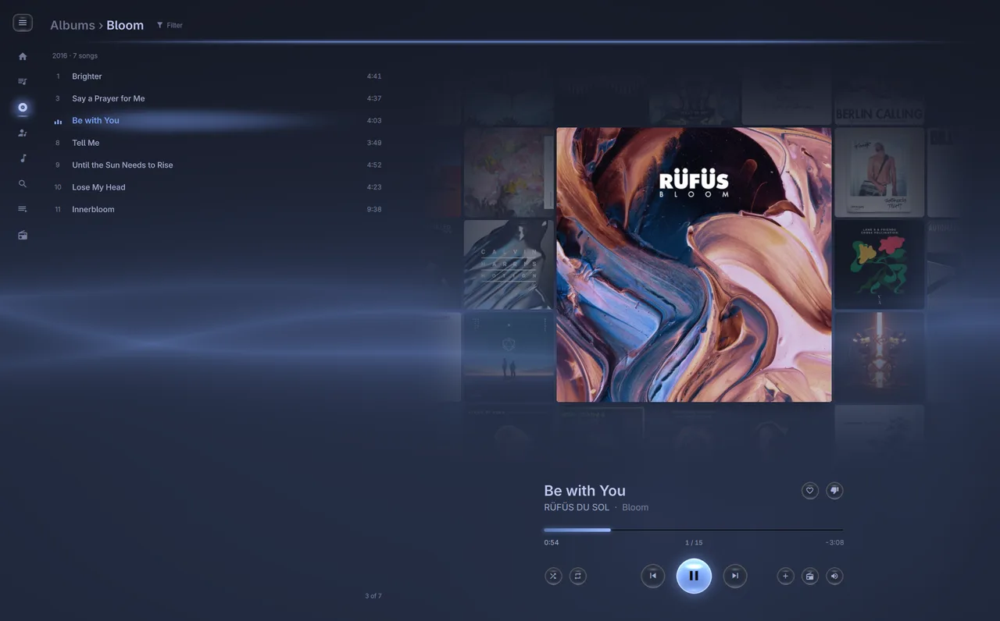

# ʕ•ᴥ•ʔ brumm


**Apple Music for [Omarchy](https://omarchy.org) & Linux, with GUI & TUI**

- 🎵 Library, catalog, search as you type
- 🏠 Home: recent, heavy rotation, picks
- 🧭 Explore: charts, genres, videos, countries
- ❤️ Favorites, Replay and playlist folders
- 🎬 Music video previews in the GUI
- 📻 Radio: your station, live, any song
- 🎤 Artists: top songs, releases, similar ones
- ♥ Love, dislike, library, playlists
- 🖼 Covers: pixel art, smooth, or real
- 🌈 Thirteen visualizers that hear the kick
- ⌨️ <kbd>?</kbd> for keys, mouse works everywhere
- 🔋 Nearly idle while paused
- 🐧 Theme colors, media keys, bar widget
- ⇄ Terminal and window, <kbd>g</kbd> to switch, music plays on
- 🎹 <kbd>Super</kbd>+<kbd>Shift</kbd>+<kbd>M</kbd> opens brumm instead of Spotify, if you like — `brumm keys on|off`

## Install

```sh
curl -fsSL https://github.com/chriopter/brumm/releases/latest/download/install.sh | bash
```

Music-video previews need Qt 6 Multimedia. The installer adds
`qt6-multimedia` on Omarchy and Arch Linux; install your distribution's
Qt 6 Multimedia QML package on other Linux systems.


TUI


GUI


Explore


Visuals

## Keys

| | |
|---|---|
| <kbd>enter</kbd> | play / open |
| <kbd>space</kbd> | pause · hold to preview |
| <kbd>←</kbd> <kbd>→</kbd> <kbd>1</kbd>–<kbd>9</kbd> | sections |
| <kbd>/</kbd> | filter here · <kbd>tab</kbd> search everywhere |
| <kbd>R</kbd> | radio from song or artist |
| <kbd>*</kbd> <kbd>d</kbd> <kbd>i</kbd> <kbd>P</kbd> | love · dislike · library · playlist |
| <kbd>f</kbd> | visualizer: <kbd>tab</kbd> <kbd>v</kbd> <kbd>a</kbd> <kbd>x</kbd> <kbd>F</kbd> |
| <kbd>g</kbd> | switch between terminal and window |
| <kbd>o</kbd> | options |
| <kbd>U</kbd> | look for an update |
| <kbd>Q</kbd> / <kbd>q</kbd> | close, keep playing / quit |

Not possible with Apple's API: deleting or renaming playlists, lyrics, lossless.

## More

- 🔑 Needs an Apple Music subscription; the installer signs you in and starts brumm
- ▶️ Later: `brumm`, the launcher, or the bar widget — whichever face you used last
- 🔄 Updates: <kbd>U</kbd> when offered, or `brumm update`
- 🔏 Signed releases (Ed25519) and GitHub-attested builds — check the installer first:

```sh
curl -fsSLO https://github.com/chriopter/brumm/releases/latest/download/install.sh
gh attestation verify install.sh -R chriopter/brumm && bash install.sh
```

## Development

The [music provider guide](docs/providers.md) describes the Rust API boundary
and the remaining work for adding another service.

The daemon and terminal player use Rust; the window uses Qt Quick/QML
with Rust for shared calculations. Building needs Rust 1.89 or newer,
Qt 6 and a C++ compiler. Go is used for development fixtures and signing
tools.

```sh
bin/setup       # build and install from this checkout (the window too, with Qt 6)
bin/dev         # the daemon in the foreground; bin/dev ui / gui for a player
bin/gui-shot    # screenshot the window against a stand-in daemon
bin/viz-thumbs  # picture each visualizer style for the list of styles
bin/bench       # what the players cost
```

One background service is the core — music, queue, library, options, sign-in, where you were. The players only draw, and come and go while the music plays on:

```text
+--------------------------------------------------------+
| brumm daemon  |  Rust / Tokio                          |
| systemd background service                             |
|                                                        |
| Apple Music API / library / queue / sign-in / options  |
+--+-----------------------------------------------------+
   |
   +-- playback --> Chrome / Widevine
   |                MusicKit JS / Web Audio
   |
   +-- MPRIS -----> Omarchy bar widget
   |
   +-- socket ----> brumm --tui
   |                Rust / Ratatui / Crossterm
   |
   +-- socket ----> brumm --gui
                    Qt Quick / QML / C++ / GLSL
                    Rust: cover colors / visualizer analysis
```

CPU, share of one core (median of three 8-second fixture runs;
terminal visualizer at 30 fps, window paced at 60 Hz):

| | paused | playing | visualizer |
|---|---|---|---|
| terminal, before (Go) | 1.25 % | 2.75 % | 7.49 % |
| terminal, now (Rust) | 0.25 % | 1.00 % | 1.87 % |
| window, before | 0 % | 5.12 % | 4.62 % |
| window, now | 0 % | 4.37 % | 4.24 % |

The terminal used 64% less CPU while playing and 75% less with its
visualizer. The window's ranges overlap; these runs show no clear gain.

The terminal writes only the cells that changed; the window hands its drawing to the GPU. These process measurements exclude the terminal emulator, Chrome and GPU work.

The [Rust migration measurements](benchmarks/rust-migration/comparison.json)
include the Go baseline, Rust results and ranges for CPU, RSS, startup and
local control latency. [bin/bench-compare](bin/bench-compare) compares built
binaries with the same fixture and isolated configuration; it never uses
the installed music session. TUI RSS fell from 33–39 MiB to 15–16 MiB;
the daemon without playback fell from 22 MiB to 7.5 MiB. Apple Music
search, DRM playback, seeking, pause/resume and the queue were also
verified with a real account in an isolated session.

Inspired by [vibez](https://github.com/simonepelosi/vibez).
