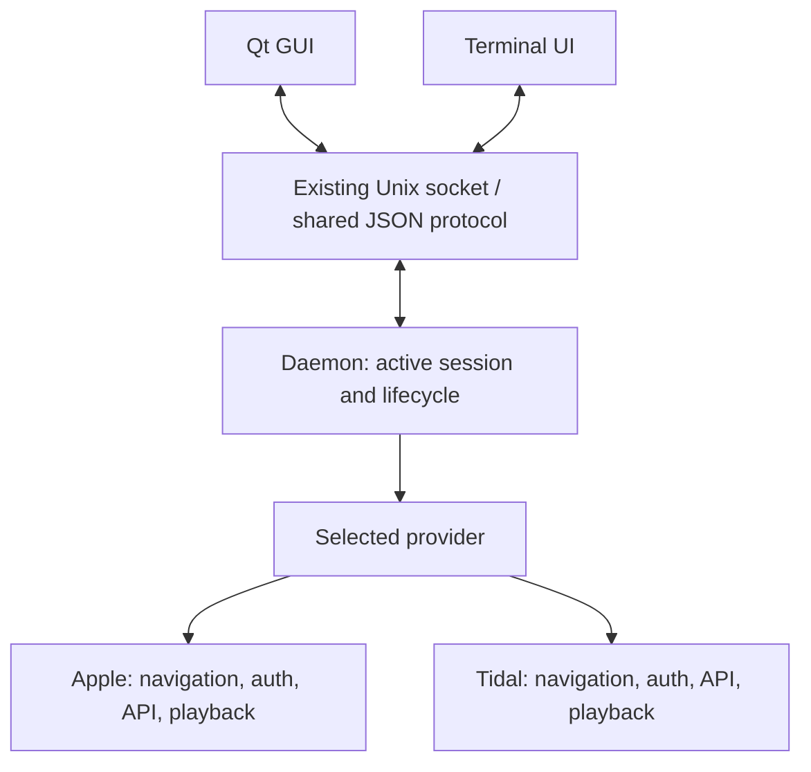

# Apple and Tidal provider abstraction plan

Status: implementation roadmap, updated 2026-10-14. Phase 0 is complete and
the Apple portion of phase 1 is implemented on branch `apple-provider-refactor`.
On `tidal-provider`, shared switching and a Tidal implementation now exist;
`providers.md` records fixture evidence and outstanding live checks. This roadmap
retains the sequence and does not claim live subscription playback is verified.

The accepted Tidal decisions, endpoint access tiers, remaining shared-contract
work and implementation sequence are in
[`tidal-provider-spec.md`](tidal-provider-spec.md). Read both documents after
resuming work; the Tidal specification supersedes the earlier tentative menu
mapping and authentication alternatives.

Baseline: author commit `cde360165a239c3f6d9c19189b42f15f9cc49980`
(“Separate Rust music providers and add first-run selection”).

## 1. Scope and decisions

Implement Apple Music and Tidal as built-in providers in Brumm. Exactly one
provider and account are active at a time. Providers compile into the application;
this plan does not introduce dynamically loaded plugins or external daemons.

The user chooses a provider, completes its authentication flow, and sees that
provider's navigation and supported actions. Switching providers stops playback
and activates the other provider's saved session, or asks the user to sign in.

Brumm supplies a consistent player and presentation. Providers supply their own
service vocabulary, browsing organization, authentication, API implementation,
and playback integration. Shared concepts do not require identical feature sets.

The prototype was preserved on branch `tidal-support`; this implementation was
restarted from the exact baseline on `apple-provider-refactor`. The current
branch targets Apple first. Tidal remains in the roadmap as the second provider.

## 2. Existing foundation and missing boundaries

The author has already extracted:

- `Catalog`, `Library`, and `Api` traits under `provider/`.
- Shared `Item`, `Track`, `Ref`, `Shelf`, `Detail`, and `ExplorePage` documents.
- A provider registry and first-run provider selection.
- Opaque navigation routes that frontends pass back to the provider.
- Partial-result handling for library and track lists.

The remaining coupling is in hardcoded frontend sections, Apple authentication
and boot checks, MusicKit playback, account storage, and action availability.
Extend those boundaries; retain the existing browse traits and shared documents
where they already express the required behavior.

## 3. Architecture and ownership



| Component | Owns |
| --- | --- |
| Provider registry | Built-in provider IDs, names, factories and availability |
| Active provider session | Account identity, authentication status, navigation and effective capabilities |
| Provider implementation | Routes, API mapping, auth flow, token refresh and service-specific playback behavior |
| Daemon | Selection, session transitions, request dispatch, cancellation and subscriber updates |
| Shared documents/protocol | Typed requests, responses, navigation, actions, errors and playback state |
| GUI and TUI | Rendering, focus, keybindings, presentation and navigation stacks |
| Shared playback infrastructure | Chrome/CDP, lifecycle, media controls and common state transport |
| Provider playback backend | MusicKit or Tidal SDK setup, credentials, SDK commands and events |

Provider switches belong in the composition/lifecycle layer. Frontend browsing,
navigation rendering and generic daemon request handlers must not branch on
`provider == "tidal"` to understand service concepts.

## 4. Provider contract

Use a provider definition to construct a signed-in session. Keep the concerns
separate, even if the initial implementation places several in one module.

| Contract | Responsibility |
| --- | --- |
| Definition | Stable provider ID, display name, authentication entry point and session factory |
| Authentication | Start, report progress, cancel, refresh, disconnect and identify the account |
| Navigation | Ordered entries with stable IDs, labels, icons and typed destinations |
| Catalog / Library / Api | Existing metadata, browse, search and supported mutation methods |
| Capabilities | Effective operations available for this account and integration |
| Playback backend | Start, control, observe and close playback through a common interface |

These are proposed contracts, not a requirement to add one trait per row.
Prefer the smallest object-safe interfaces that remove existing coupling.

Availability and capability are different: an implemented provider can be chosen
before sign-in, while account permissions may determine which actions work after
sign-in. Token scopes are evidence for permissions, not proof that every API or
SDK feature is usable. Backends still validate each operation.

## 5. Provider-defined navigation

Each active session returns an ordered navigation description. An entry has:

- `id`: stable within the provider, independent of its label or position.
- `label`: provider-selected wording.
- `icon`: semantic icon key rendered by each frontend.
- `destination`: a typed page, library list, or search destination.
- Optional presentation hints restricted to views Brumm supports.

Example wire shape (proposed):

```json
{
  "id": "home",
  "label": "Home",
  "icon": "home",
  "destination": { "kind": "page", "route": "tidal:home" }
}
```

`page` uses the existing Explorer request/document mechanism. A library
destination identifies a supported list; search uses the shared search flow.
Providers cannot send executable QML, JavaScript, shell commands, or arbitrary
frontend commands as destinations.

Brumm-owned utilities such as Queue, Settings, provider selection and help stay
available independently of provider navigation. Providers do not redefine player
controls. Numeric shortcuts derive from the displayed order; persistence uses
entry IDs rather than numeric section indexes or labels.

Both frontends build navigation stacks from these entries. Selecting a page
sends its opaque route to the daemon. Neither frontend constructs service API
URLs or infers behavior from an ID prefix.

Apple describes its existing navigation first. Tidal describes its own navigation
through the same contract. The user approved direct access to collection
categories and Tidal-native Home/Explore organization:

| Entry | Accepted contents |
| --- | --- |
| Home | Native personal surfaces, with endpoint access verified individually |
| Explore | Native editorial/discovery surfaces, when accessible to this client |
| Playlists | My Playlists |
| Albums | My Albums |
| Artists | My Artists |
| Tracks | Favorite tracks; shared library destination remains `songs` |

Tidal account-wide Recently Played remains an API investigation. Your History
contains most-listened mixes and must retain that meaning. Collection categories
are directly accessible; My Mix can be linked from Home when there is no Collection
landing page. Folders and advanced playlist edits are deferred. The specification
records the precise destination and action mappings.

## 6. Shared primitives and capabilities

Keep a compact, typed vocabulary. Do not make every service operation a generic
string command.

| Primitive | Meaning |
| --- | --- |
| Open / search / play | Navigate or play resources from the active provider |
| Favorite | Set or clear a provider's positive preference on supported resource kinds |
| Save to collection | Add or remove a resource from a saved collection |
| Follow artist | Follow or unfollow, where supported |
| Playlist operations | Create, add tracks, rename, delete; subject to resource permissions |
| Recommendation feedback | Separate negative feedback or blocking, where supported |
| Playback controls | Play/pause, seek, next/previous, volume, shuffle and repeat |

Favorite, collection membership, artist following and recommendation blocking
are distinct states. A provider may map two operations to the same remote state;
it must declare that relationship so the UI does not show duplicate actions or
assume changing one changes another. Tidal's saved-track favorite is one such
case to check; Apple's existing love and library behavior must be preserved.

Capabilities describe supported resource kinds, readable states, allowed
mutations and labels. Resource permissions refine them: a provider supporting
playlist rename does not make every playlist editable.

Use explicit desired-state commands for toggles, such as `favorite = true`,
rather than retry-sensitive “toggle” mutations. Unknown state differs from false.
Hide unsupported actions; show authentication/permission failures appropriately.
An unsupported operation remains a structured error at the backend boundary.

Provider-specific settings such as quality use typed choices and labels supplied
by the integration. Brumm retains shared settings such as volume and appearance.
Avoid a general settings-schema framework unless these two providers require it.

## 7. Socket contract

Keep the existing Unix domain stream socket at
`$XDG_RUNTIME_DIR/brumm.sock` (with Brumm's existing cache-directory fallback),
newline-delimited JSON, request IDs, replies and subscribed state updates.

The socket is the frontend/daemon boundary. The Rust provider interfaces are the
daemon/service boundary. There is no separate Tidal socket.

Add shared protocol documents for:

- Provider choices and the active provider's navigation/capabilities.
- A public authentication prompt and progress state.
- Active provider/session generation.
- Structured error categories with user-facing messages.
- Shared action states and permissions where existing fields are insufficient.

Illustrative active-session message:

```json
{
  "provider": {
    "id": "tidal",
    "generation": 12,
    "authStatus": "signed-in",
    "navigation": [],
    "capabilities": {}
  }
}
```

Reuse existing `explore`, `search`, `list`, `open` and playback commands where
possible. The new navigation contract can route page entries through `explore`;
legacy `home` and named feature entry points can delegate during migration.
Keep existing command meanings intact. Add schema/protocol version negotiation
before depending on new fields; define a clear error for incompatible builds.

Provider-bound requests include the active generation. Reject stale commands,
especially mutations, rather than applying an old provider's ID to a new provider.
Replies and events carry their originating generation; frontends discard stale
results. Brumm-owned commands such as reading available providers do not require
a signed-in session.

Never send access tokens, refresh tokens, client secrets, or private device codes
over the frontend socket. A public user code and verification URL may appear in
an authentication prompt. Routes must be validated before authenticated network
requests and contain no credentials.

## 8. Authentication and account storage

The shared auth surface reports a small state machine:

`signed-out → signing-in → signed-in`, with cancellation and recoverable error
states. Refresh occurs inside the provider session. An expired or revoked session
returns to authentication without discarding the other provider's saved account.

Apple retains its existing sign-in flow. Tidal uses the working device-linking
approach from Untidy and the preserved prototype. The user confirmed reuse of
this approach; device login is settled for this implementation. Do not request
a registered-client ID or redirect URI as a prerequisite. Record the compatibility
client dependency and verify refresh, endpoint access and playback behavior as
part of implementation and release evidence.

The common authentication prompt supports browser approval and device linking.
It provides public display data, expiry where applicable and cancellation. Each
provider owns its private flow state, polling, callback validation and refresh.

Persist the selected provider separately from each provider's credentials.
Initially retain one saved account per provider. Credential records are private;
browser profiles and account-derived caches are isolated by provider and account.

Migration preserves existing Apple credentials and automatically selects Apple
for an existing Apple installation. Switching retains saved credentials;
disconnecting clears the selected provider's credentials and private session
data. Neither action clears another provider's account.

## 9. Playback boundary

Keep one common control and state contract: ready/error, playing, current track,
queue/index, position/duration, volume, shuffle and repeat. A playback session has
one authoritative queue; frontends display snapshots rather than maintain a
second playback queue. Preserve the current queue semantics during extraction.

The shared engine provides Chrome/CDP and lifecycle infrastructure. Apple and
Tidal backends implement their SDK setup, credential handoff, playback commands,
event translation and service errors behind that engine boundary.

A catalog adapter returning metadata is insufficient to enable a provider.
Playback initialization and live playback must also work. SDK-specific quality
or preview behavior must be declared through supported options/capabilities,
not inferred by generic UI code.

Switching never mixes queues or transfers track IDs between services. Each
provider may restore its own saved queue, paused by default, after its account
identity is confirmed.

## 10. Switching lifecycle and stale-work protection

The daemon serializes provider transitions:

1. Mark the session as switching and advance its generation.
2. Reject new commands for the previous generation; cancel login and API work.
3. Stop playback and close the previous backend and private credential bridge.
4. Save the outgoing account's permitted resume/navigation state.
5. Clear active UI state and install the selected provider definition.
6. Validate or refresh its saved credentials, or report that sign-in is needed.
7. Load account-specific state, navigation and capabilities; initialize playback.
8. Publish the new session snapshot and allow its supported commands.

Cancellation alone is insufficient: already completed requests and SDK callbacks
must also pass provider/account/generation checks before updating UI or caches.
Credentials are obtained from the owning session, not whichever provider happens
to be selected when a request resumes.

A failed switch leaves a coherent error/sign-in screen for the newly selected
provider and lets the user select another. It must not show the old provider's
library under the new provider's name.

## 11. Clean implementation sequence

### Phase 0: preserve and restart

- Preserve all prototype source, generated assets, dependency locks and findings
  on a separate branch/snapshot. Exclude personal tokens, credentials and logs.
- Create a clean branch or worktree from the exact author baseline.
- Record useful findings: Tidal device linking, valid include paths, the include
  limit, artist request parameters, and the unverified audio/release questions.

### Phase 1: shared contracts, implemented by Apple

- Introduce navigation, capabilities and auth progress types. Session generations
  remain phase 2 work.
- Extract the provider composition/auth/playback boundaries.
- Describe Apple's existing navigation and behavior through those contracts.
- Refactor both frontends to render entries and use stable IDs.
- Preserve old Apple config, navigation and IPC behavior during migration.

Milestone: Apple navigation, authentication, API composition and playback page
are behind the provider contract. Both frontends consume provider navigation
and capabilities; fixture and baseline comparisons cover browsing and player
presentation. Live subscription playback remains unverified because no Apple
Music subscription is available.

### Phase 2: switching and storage

- Separate selection from saved credentials and partition account state.
- Implement serialized lifecycle transitions and stale-request rejection.
- Exercise signed-out, signed-in, cancelled and failed sessions with fixtures.

Milestone: transition behavior is deterministic before introducing live Tidal.

### Phase 3: Tidal behind the same interfaces

- Bring over reviewed device authentication and token refresh.
- Add catalog, collection, navigation and action mappings.
- Integrate its playback backend with the common control contract.
- Implement the supported equivalents of Brumm's functions, explicitly declaring
  unsupported features instead of inventing Apple-equivalent semantics.

Milestone: Tidal requires provider implementation and registration, not Tidal
branches throughout shared application code.

### Phase 4: live validation and PR preparation

- Confirm API reads, supported writes, authentication expiry/cancellation,
  playback, queue behavior and switching for both services.
- Review the diff for boundary leaks, migration behavior, dependency licenses
  and release packaging.
- Prepare the upstream PR with the architecture, validation and remaining
  limitations. Publication is a separate step after the result is reviewable.

## 12. Validation plan and completion criteria

Planned checks, not results already obtained for the new architecture:

- Shared contract tests using fictional Apple/Tidal data and auth states.
- GUI and TUI tests for dynamic entries, stable-ID restoration and capabilities.
- Daemon tests for switching during login, reads, writes and playback callbacks.
- Storage tests for provider/account isolation and legacy Apple migration.
- API tests for pagination, duplicates, partial results and mutation permissions.
- Live sign-in, refresh, browse and playback checks for Apple and Tidal.
- Repeated Apple → Tidal → Apple switches without stale data or renewed login
  when the saved sessions remain valid.

Desktop work runs in omabox. Its lack of audio output means an authorized real
desktop check is still needed to verify audible playback and audio behavior.
No production mutation should be used merely as a fixture; live write checks
use explicitly authorized, disposable resources.

The abstraction is complete when both providers use the same frontend and daemon
contracts, existing Apple users retain working sessions, each provider presents
its own navigation, unsupported controls are absent, and switching cannot leak
credentials, IDs, cached results or playback between sessions.

## 13. Questions to settle during implementation

- Can Tidal expose account-wide Recently Played through a usable endpoint?
- Which native Home/Explore endpoints can the chosen device client access? The
  inspected dynamic-page and feed endpoints are marked INTERNAL in the schema.
- Does the playback SDK deliver full tracks for this client/account, and which
  quality levels work on Linux?
- Can favorite state and owned/favorited playlist lists be read and changed
  reliably through the selected session? One positive collection action is the
  approved Tidal mapping; advanced playlist edits/folders are deferred.
- Which compatibility shim is needed for old saved navigation and GUI builds?

These questions affect adapters and migration details. They should not force
provider-specific concepts into the shared navigation or socket transport.
